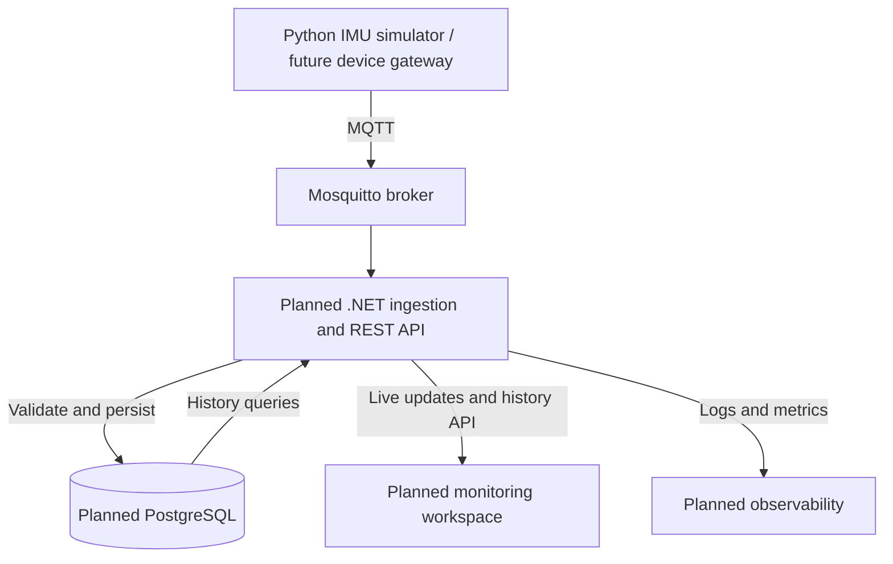

# Connected Motion Sensor Platform

**From simulated sensor signals to connected, observable systems.**

Connected Motion Sensor Platform is a personal software engineering project exploring how motion data travels from a device, through a communication layer, into reliable application services and eventually a monitoring interface.

It starts with software-only IMU sensors and a local MQTT pipeline, with a planned C#/.NET backend, PostgreSQL persistence, REST API, and real-time monitoring workspace.

**Work in progress:** the current implementation generates stationary IMU data, validates versioned messages, and publishes/subscribes through an authenticated Mosquitto broker. Device-status and Last Will demonstrations and an automated acceptance runner are implemented, with real-broker status acceptance still pending. The .NET backend, database, and graphical monitoring interface are planned features.

[Getting Started](#getting-started) · [System Architecture](#system-architecture) · [Verification](#verification) · [Real-Time Monitoring Interface](#real-time-monitoring-interface-planned) · [Roadmap](#roadmap) · [Documentation](#documentation)

## Why I Built This Project

My software engineering work has involved connecting application behavior with external systems: sensor-integrated medical applications, real-time motion data, interactive environments, REST APIs, and cloud services.

These experiences made me interested in the engineering between components. A sensor can produce valid data while an application displays stale information. A connection can succeed while a message is rejected. A message can be acknowledged before anything has been durably stored.

I started this project to investigate those boundaries across a complete system: **how do we collect, transport, validate, store, observe, and explain device data—and what happens when part of the chain fails?**

The aim is to deepen my backend, database, Linux, communication, and verification skills through a system that other developers can inspect and run. It also provides a foundation for later work in industrial HMI, medical monitoring interfaces, and robotics visualization.

## The Problem

A connected-device demonstration can look successful when values appear in a terminal. A maintainable platform needs clearer answers:

- Which device and sampling stream produced this observation?
- Are units, timestamps, and coordinate conventions consistent?
- Was a message accepted by the broker, received by a consumer, or committed to storage?
- How should duplicate, missing, conflicting, and late messages be handled?
- Does an online announcement describe current connectivity or only the last known state?
- Can someone reproduce a failure and use evidence to locate the failing layer?

The project approaches these questions incrementally, with explicit contracts, small runnable slices, tests, and Architecture Decision Records (ADRs).

## Project Vision

The target is a locally reproducible connected sensor platform:

**Device → Communication → Backend → Database → Real-Time Monitoring Interface**

The first devices are Python simulators because no physical sensor hardware is required. They publish MQTT directly; they do not emulate BLE/GATT. A future ESP32/IMU gateway can become another adapter to the same application contract.

The project remains a simulated-device engineering exercise. Industrial protocols, robotics integration, and hardware support are optional extensions. It is not a clinical monitoring product, a validated sports-recognition system, or a hard-real-time controller.

## Current Features

| Area | Implemented behavior | Verification boundary |
| --- | --- | --- |
| Virtual IMU | Stationary acceleration and angular velocity with bounded synthetic noise and seeded generation. | Offline signal and contract tests; noise is illustrative rather than calibrated. |
| Sample identity | Device ID, stream UUID, sequence, UTC sampling time, and stable per-stream message IDs. | Fixed generation inputs reproduce complete messages; CLI runs create a fresh stream and start time. |
| Message contracts | JSON Schema, positive/negative examples, topic/payload identity checks, and finite-number validation. | 46 contract checks. |
| Local broker | Mosquitto in Docker Compose, loopback port, authentication, role ACLs, and named volumes. | Windows startup, connection-refusal, and role checks recorded. |
| Python MQTT path | Separate publisher and subscriber, MQTT v5 reason-code handling, QoS 1 non-retained telemetry, and bounded waits. | A ten-message Windows run has matching sent/received identities and contiguous sequence. |
| Device channels | Explicit device topics and independently selected device IDs. | Two-device reception is owner-confirmed; it is not a concurrency benchmark or device-identity security test. |
| Subscriber validation | Schema validation, identical-duplicate suppression, conflicting-duplicate rejection, and single-stream sequence checks. | In-memory demo checks; durable deduplication is not implemented. |
| Device status | Retained online/offline announcements, connection IDs, a graceful exit, and a pre-registered Last Will. | Unit checks exist; recorded real-broker status acceptance is pending. |
| Status acceptance tool | Observe graceful and intentional process-exit transitions, then verify retained offline with a new subscriber. | Implemented and covered by offline assertions; its real-broker run remains to be accepted. |
| Engineering documentation | Eight ADRs, architecture, phase records, evidence files, and Chinese/English learning material. | Plans and recorded execution results are distinguished. |

Current simulation implements **idle only**. Motion, jump, landing, integrated multi-device generation, and automatic reconnection remain future work. The JSON contract's scenario vocabulary does not imply that those generators or a motion detector already exist.

## System Architecture

### Current runnable path

The publisher and subscriber run as separate Python processes on Windows. Both connect to a Mosquitto Linux container through `127.0.0.1:1883`. The subscriber validates received observations in memory and prints them to the terminal.

The status demonstration is a separate entry point; its lifecycle has not yet been integrated into the telemetry publisher. No database or web application participates in the current path.

### Target architecture

The diagram describes the intended platform. **The .NET backend, PostgreSQL, monitoring UI, and observability services are not implemented yet.**



The backend is designed as one modular deployment initially: an MQTT background adapter, validation/persistence use cases, database access, and REST endpoints. Independent services or Kubernetes will be considered only if measured scaling or availability requirements justify them.

### Data contracts

| Topic | Intended use | QoS / retained |
| --- | --- | --- |
| `motion/v1/devices/{deviceId}/telemetry` | One IMU observation per JSON message. | QoS 1; not retained. |
| `motion/v1/devices/{deviceId}/status` | Last announced connection state. | QoS 1; retained. |

Telemetry includes `schemaVersion`, `messageId`, `deviceId`, `streamId`, `sequence`, `sampledAt`, `accelerationMps2`, and `angularVelocityRadps`.

Acceleration uses m/s² and includes the stationary gravity response; angular velocity uses rad/s. The device-local frame is right-handed: X forward, Y left, Z up. An idle sensor with Z up reports approximately `(0, 0, 9.81)` m/s². The default 10 Hz logical sampling schedule supports debugging; it is not a validated motion-analysis requirement or a hard-real-time guarantee.

See the [contract guide](docs/mqtt-contract.md) and [schemas/examples](contracts/mqtt/v1). Generator reference labels must remain separate from detector inputs; reading a `jump` label would not establish successful jump recognition.

## Technical Stack

| Layer | Current implementation |
| --- | --- |
| Sensor generation and verification | Python; `unittest`; standard-library signal generation and CLI tools. |
| MQTT client | `paho-mqtt==2.1.0`, MQTT v5, callback API version 2. |
| Contract validation | `jsonschema[format]==4.26.0`. |
| Broker | `eclipse-mosquitto:2.1.2-alpine`, password-file and ACL-file plugins. |
| Local infrastructure | Docker Compose, Linux containers, named volumes, and loopback networking. |
| Development | Windows PowerShell; Docker Desktop with a WSL2-backed Linux engine. |
| Documentation | Markdown, Mermaid, HTML learning guides, ADRs, and recorded test output. |

**Planned:** C#/.NET and ASP.NET Core, PostgreSQL, a version-compatible EF Core/Npgsql integration, application containers, CI, structured backend diagnostics, and the monitoring interface. Their versions and the UI stack will be selected when their implementation slices begin. No frontend framework has been adopted in this repository.

## Getting Started

The instructions below reproduce the current Python/MQTT slice on **Windows PowerShell**. They do not start the future complete platform.

### Prerequisites

- Git.
- Python 3.12; the recorded Windows setup uses Python 3.12.3.
- Docker Desktop running with Linux containers and Docker Compose.
- Local access to port `1883` and the ability to pull the Mosquitto image.

No sensor hardware, Azure subscription, .NET SDK, database, Node.js, or separate Ubuntu installation is needed for this slice.

### 1. Clone and install Python dependencies

```powershell
git clone https://github.com/huizi135/ConnectedMotionSensorPlatform.git
Set-Location ConnectedMotionSensorPlatform
py -3.12 -m venv .venv
.\.venv\Scripts\python.exe -m pip install -r simulator/requirements-mqtt.txt
```

For an existing checkout, inspect `git status` and `git branch --show-current` before updating with `git pull --ff-only`. Keep existing local credentials. Explicitly invoking the virtual-environment interpreter avoids requiring PowerShell activation.

### 2. Check the offline generator and tests

```powershell
.\.venv\Scripts\python.exe -m unittest discover -s tests -v
.\.venv\Scripts\python.exe tools/validate_contracts.py
.\.venv\Scripts\python.exe -m simulator --samples 3 --seed 42
```

Expected: **25 unit tests pass**, **46/46 contract checks pass**, and three valid JSON observations are printed. Offline generation outputs immediately; its timestamp intervals do not pace wall-clock execution. The seed fixes noise, while the CLI creates a new stream ID and sampling start on each run.

### 3. Initialize and start the broker

Open Docker Desktop, wait for the engine, then run:

```powershell
docker info --format '{{.OSType}}'
.\.venv\Scripts\python.exe tools/initialize_mqtt.py
docker compose -f infrastructure/compose.yaml up -d mosquitto
docker compose -f infrastructure/compose.yaml ps
docker compose -f infrastructure/compose.yaml logs --tail 40 mosquitto
```

Expected engine type: `linux`. The broker should be `Up`, with `127.0.0.1:1883->1883/tcp`, and authentication/ACL plugins loaded.

Initialization generates local `simulator` and `backend` credentials in the ignored `secrets/mqtt/clients.json` file. The simulator role can publish telemetry/status topics; the backend role can subscribe. Password hashes and ACLs are installed into the broker's auth volume. Existing credentials are reused; missing local credentials with an already initialized auth volume cause a refusal rather than a silent password reset.

### 4. Run the broker smoke check

```powershell
.\.venv\Scripts\python.exe tools/test_mqtt_broker.py
```

This checks host TCP reachability, anonymous/wrong-password refusal, backend publish denial, and identical JSON delivery through a short-lived registered session. Its MQTT CLI clients execute inside the container; the next step separately exercises Windows-native Python clients.

### 5. Receive and publish ten observations

In **terminal A**, from the repository root:

```powershell
.\.venv\Scripts\python.exe -m simulator.mqtt_demo subscribe --samples 10
```

Wait for `READY: subscription accepted`. In **terminal B**, enter the same repository directory and run:

```powershell
.\.venv\Scripts\python.exe -m simulator.mqtt_demo publish --samples 10
```

The publisher should print acknowledgments for sequences `0–9` and `PASS publisher`. The subscriber should print ten JSON observations and `PASS subscriber`. Both results are required. Start publication within the subscriber's default 120-second wait.

Use the same `--device-id` value in both commands to select another device channel. A subscriber in this demo expects one stream beginning at sequence zero; this is an acceptance rule, not the future backend's general late-data policy.

### 6. Explore device status

The status implementation can be inspected manually with `python -m simulator.status_demo watch`, `device`, and `snapshot`, using the project interpreter. Follow the [status walkthrough](docs/Phase1_Device_Status_ZH.html) for the required order.

For the automated real-broker acceptance run:

```powershell
.\.venv\Scripts\python.exe tools/test_status_lifecycle.py
```

The runner subscribes first, launches unique one-second demo devices, checks graceful offline and an intentional process crash, and verifies the resulting retained snapshots with new subscribers. Exit `17` is expected for the child simulating a crash; the parent should finish with `PASS status lifecycle`. Cleanup targets only the runner's own retained topics.

**This runner is provided for local verification; a successful real-broker status run has not yet been recorded in the repository.** Offline tests do not establish that result.

### Stop the local broker

```powershell
docker compose -f infrastructure/compose.yaml down
```

Named volumes remain. Avoid `down -v` as a troubleshooting shortcut: it removes broker state, including initialized authentication data.

### Troubleshooting

| Symptom | First check |
| --- | --- |
| Docker engine pipe is missing | Open Docker Desktop and wait for its Linux engine. |
| `WinError 10061` / connection refused | Confirm broker process, loopback address, and port mapping before changing credentials. |
| `ModuleNotFoundError` | Use `.venv`'s interpreter and install the repository requirements. |
| Authentication or publish refusal | Inspect MQTT reason codes and the relevant credential/ACL role. Do not enable anonymous access to bypass a failed test. |
| Subscriber times out | Wait for `READY` before publishing; match device IDs and sample counts. |
| Unexpected sequence or stream | Check for another publisher or a subscriber started after the stream began. |
| Status watcher shows `CACHED` | A retained announcement was replayed; it is not a newly observed live transition. |
| Initialization reports lost credentials | Preserve the existing files/volumes and investigate; do not silently rotate or delete them. |

## Engineering Challenges

| Challenge | Current approach | Remaining work |
| --- | --- | --- |
| Cross-component data meaning | Versioned schemas, explicit units/frame, topic/body identity checks. | Enforce the same rules in .NET and database mappings. |
| Reproducible simulation | Isolated generator with explicit seed, stream, time, and sequence. | Motion scenarios, separate reference datasets, and concurrent generation. |
| Protocol success versus process success | Inspect MQTT v5 reason codes; recognize explicit CLI publish refusal even when exit code is zero. | Extend equivalent checks through ingestion and storage. |
| Test readiness | Native Python callbacks; broker smoke uses explicit subscription completion and bounded sessions. | Broader automated multi-process and failure experiments. |
| Presence and stale information | Retained state, connection identity, null timestamp for a preconstructed Will, and cached/live distinction. | Real-broker acceptance, integrated lifecycle, reconnect, and activity-timeout policy. |
| Persistence guarantees | Distinguish broker acknowledgment, consumer reception, and durable commit. | PostgreSQL transactions, constraints, durable deduplication, and DB-outage tests. |

Earlier CLI readiness checks timed out while parsing live debug output. The test was redesigned around explicit completion events and later native MQTT callbacks. The exact original output-path root cause was not confirmed; changing the test is not evidence of fixing a broker defect.

## Verification

The README review on **2026-11-12** uses implementation commit [`e347969`](https://github.com/huizi135/ConnectedMotionSensorPlatform/commit/e347969f5e8dbf31fc66f271129da14fcc7e298c) as its baseline.

| Evidence | Recorded result |
| --- | --- |
| Offline Python suite | 25 tests pass in the author environment; the first five idle tests also have recorded Windows output. |
| Contract regression | 46/46 checks pass, with existing Windows execution evidence. |
| Broker checks | Windows initialization, startup, role refusal checks, and smoke delivery recorded. |
| Native Python MQTT | Ten matching published/received message IDs and sequences recorded on Windows. |
| Two-device exercise | Owner-reported subscription/reception success; no measured scale claim. |
| Device-status integration | Source and automated runner exist; real-broker acceptance pending. |
| CI / backend / database / UI | No workflow run or implementation is present for these areas. |

See the [test records](docs/testing) for commands, dates, environments, and limits. There is no GitHub Actions workflow or passing CI badge. Broker and Windows evidence comes from earlier local runs; the documentation review does not rerun Docker or establish new network/persistence guarantees.

## Real-Time Monitoring Interface (Planned)

The next application layer, after backend ingestion and storage, is a monitoring workspace for understanding device behavior. It is intended to connect my experience in real-time integration and interactive applications with industrial HMI, medical-monitoring UI, and robotics-visualization problems.

| Planned capability | Engineering purpose | Dependency |
| --- | --- | --- |
| Device overview | Show announced state, last activity, and stale/disconnected conditions. | Backend presence model and status API. |
| Live IMU curves | Inspect acceleration and angular velocity with units and device/stream identity. | Bounded backend live delivery and bounded UI buffers. |
| Connection diagnostics | Make reconnects, rejected messages, gaps, and stale data visible. | Structured events and defined failure states. |
| Latency indicators | Distinguish sampling, reception, processing, and commit times. | Instrumentation and explicit clock assumptions. |
| Historical queries | Filter by device/time and inspect stored observations. | PostgreSQL and paginated REST endpoints. |

The UI will consume backend APIs/live updates rather than connect directly to PostgreSQL. Frontend framework, live transport, refresh/downsampling strategy, and accessibility decisions are pending design work. Browser rendering rate will be treated separately from device sampling rate.

The intended first acceptance scenario is a local device run that appears live, produces queryable history, and shows a visible stale/disconnected state during a controlled interruption. This is a planned verification scenario, not a shipped interface or a medical/industrial safety claim.

There is currently **no graphical dashboard, hosted demo, or screenshot set** in this repository. The runnable demonstration is terminal-based; HTML documents provide learning material, not a live monitoring product.

## Reliability & Security Boundaries

- **Delivery:** QoS 1 allows duplicate delivery. A successful PUBACK is not a database commit. The current system does not promise end-to-end exactly-once processing or complete offline replay.
- **Timing:** Python, ordinary .NET, and general-purpose Linux/Windows scheduling do not establish hard-real-time guarantees. Logical sample timestamps are not measured transport latency; cross-host clock offsets must be accounted for.
- **Presence:** retained state is the last announcement. Will delivery depends on the broker detecting an unexpected disconnect; it does not provide the precise failure time or cover broker unavailability by itself.
- **Local access:** the broker publishes only on `127.0.0.1:1883`; transport is local TCP without TLS. Remote deployment requires a separate security design.
- **Identity:** shared simulator/backend roles enforce operation boundaries, not independent per-device authentication or tenant isolation.
- **Credentials:** generated files under `secrets/` stay out of Git. Local development clients can access their credentials; some ephemeral CLI checks pass them as process arguments. This is not production secret management.
- **Data:** examples use synthetic sensor observations. No physical hardware, proprietary motion algorithm, patient data, or real-world recognition accuracy is part of the current demonstration.

## Roadmap

| Phase | Status | Scope |
| --- | --- | --- |
| 0 — Design foundation | Baseline established | Architecture, contracts, repository conventions, ADRs, and bilingual documentation. |
| 1 — Virtual devices and MQTT | In progress | Idle signals and basic MQTT path verified; finish status acceptance, integrated lifecycle, scenarios, concurrent devices, and basic reconnect. |
| 2 — Backend and persistence | Planned; next major priority | PostgreSQL schema/migrations/SQL, .NET MQTT consumer, constraints/deduplication, and REST history queries. |
| 3 — Deployment and observability | Planned | Backend containers, complete Compose, health checks, structured logs, CI/build verification, then metrics and dashboards. |
| Monitoring workspace extension | Planned after backend/API foundation | Device state, live curves, diagnostics, latency interpretation, and historical inspection. |
| 4 — Reliability and capacity | Planned | Bounded buffering/backpressure, outages/crashes, duplicates/order/gaps, and measured multi-device load. |
| 5 — Data and analytics | Planned | Quality checks, features, independently evaluated rule-based events, and analysis-ready datasets. |
| 6 — Optional adapters | Deferred | ESP32/IMU/BLE, OPC UA first where useful, ROS 2 bridge for robotics integration, and later cloud/IaC. |

CI will be added alongside the relevant implementation slices rather than postponed until every feature exists. OPC UA, ROS 2, paid cloud services, and Kubernetes are not prerequisites for the core local platform. See the [detailed engineering roadmap](docs/engineering-roadmap.md).

## Repository Guide

| Path | Contents |
| --- | --- |
| [`simulator`](simulator) | Offline signal generator, native MQTT demo, status lifecycle demo, and dependencies. |
| [`contracts/mqtt/v1`](contracts/mqtt/v1) | JSON schemas, sample messages, and contract vectors. |
| [`infrastructure/compose.yaml`](infrastructure/compose.yaml) | Mosquitto service, opt-in auth initialization helper, and named volumes. |
| [`infrastructure/mosquitto`](infrastructure/mosquitto) | Broker configuration, role ACL, and credential initialization. |
| [`tools`](tools) | Setup, contract validation, broker smoke, and status acceptance helpers. |
| [`tests`](tests) | Offline signal, MQTT-result, status, and acceptance-assertion tests. |
| [`docs/adr`](docs/adr) | Recorded decisions, alternatives, costs, and reconsideration conditions. |
| [`docs/testing`](docs/testing) | Verification evidence and explicit limits. |
| [`docs`](docs) | Architecture, roadmap, English/Chinese phase guides, and interview-oriented explanations. |

## Documentation

Start with [Architecture](docs/architecture.md), [MQTT Contract](docs/mqtt-contract.md), [Broker Setup](docs/phase-1-mosquitto.md), or the [Engineering Roadmap](docs/engineering-roadmap.md).

Chinese learning guides include [Phase 0 explanation and interview Q&A](docs/Phase0_Explanation_Interview_QA_ZH.html), [Python MQTT](docs/Phase1_Python_MQTT_ZH.html), [Device Status](docs/Phase1_Device_Status_ZH.html), and the [Current Technical Roadmap](docs/Engineering_Roadmap_ZH.html). The original [English](docs/Connected_Motion_Platform_Phase0_EN.html) and [Chinese](docs/Connected_Motion_Platform_Phase0_ZH.html) design guides are retained.

GitHub shows HTML source; open checked-out HTML files in a browser for their formatted versions. Earlier phase documents may contain historical plans and setup snapshots. Current implementation/status descriptions in this README and dated evidence should be used to distinguish planned architecture from shipped code.

## Development Status & Attribution

**Personal project · Work in progress · Simulated devices · Local development**

This is an independent engineering project inspired by sports motion-tracking problems, including the product domain of Aiving's Jump Tracker. It does not reproduce proprietary algorithms or internal architecture. The project complements my professional experience; it is not presented as production industrial, robotics, or medical-system deployment.

The next work is to accept the existing device-status slice, complete the minimal simulator lifecycle, and build the backend/database path that will support a meaningful monitoring interface.

## License

No `LICENSE` file is currently included, and an open-source license has not been selected. This README does not grant an open-source license. Third-party dependencies remain subject to their own licenses.
