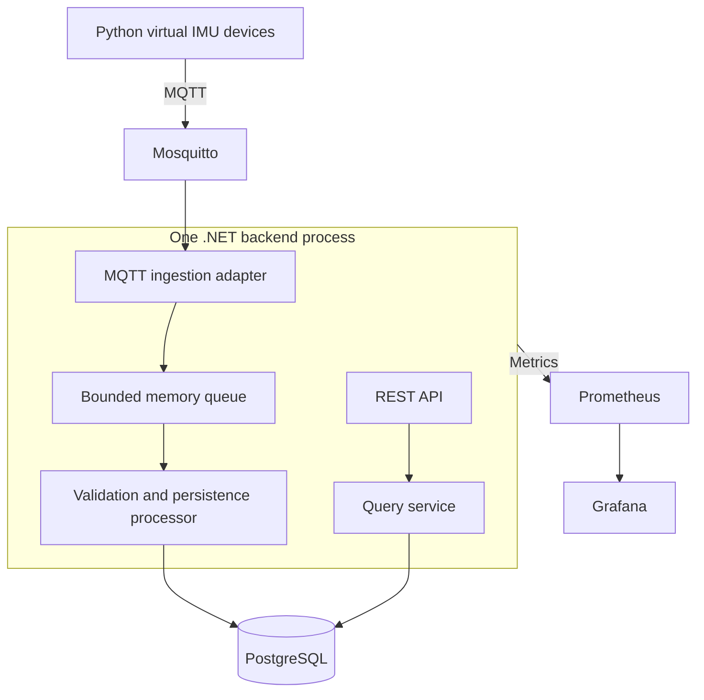

# System architecture

Status: Phase 0 design baseline. Implementation and runtime guarantees remain unverified.

## Purpose and constraints

Build a reproducible local motion-sensor pipeline to practice device-to-cloud
engineering, reliability, observability and data analysis. No physical hardware
is available. Windows is the initial development environment. The complete MVP
must run without paid cloud services.

Python provides simulated signals and later analytics. C#/.NET provides the
backend. Versions will be checked and pinned when implementation begins.

## MVP architecture

This diagram describes the intended MVP after Phases 1–3. Phase 1 implements
only the simulator, broker and verification subscriber. None of the services
in this diagram has been implemented or tested in this project yet.

## Responsibilities and boundaries

| Module | Responsibility | Boundary |
| --- | --- | --- |
| Simulator | Generate reproducible signals, stable sample identity and device status | No backend business logic and no BLE/GATT emulation |
| Broker | Connections, topic routing and MQTT delivery behavior | Not the historical database |
| MQTT adapter | Subscribe, extract topic identity and pass incoming messages to processing | No motion detection |
| Processor | Validate contracts, handle duplicates/conflicts and persist samples | Does not infer persistence from MQTT acknowledgment |
| Database adapter | Transactions, constraints, migrations and queries | PostgreSQL details stay behind application interfaces |
| REST API | Device and bounded historical queries | Explicit time ranges, page limits and stable ordering |
| Observability | Structured logs, aggregate metrics and health checks | Avoid unbounded message/device metric labels |
| Later analytics | Quality checks, features and independently inferred events | Reference labels excluded from inference inputs |

Use one backend deployment initially. Keep application use cases separate from
MQTT and database adapters. Split processes only when measured resource
interference, availability needs or scaling requirements justify it.

## Data contract baseline

Planned topics:

- `motion/v1/devices/{deviceId}/telemetry`: QoS 1, not retained.
- `motion/v1/devices/{deviceId}/status`: QoS 1, retained.

Each telemetry message initially contains one JSON sample with `schemaVersion`,
`messageId`, `deviceId`, `streamId`, `sequence`, `sampledAt`, acceleration and
angular velocity. Detailed schemas and examples are the next Phase 0 task;
the contract is not frozen by this document.

- A sample retains its message identity, sequence and sampling timestamp on retry.
- A process restart creates a new sampling stream. Reconnection alone need not.
- Topic and payload device identity must agree.
- Use UTC timestamps, m/s² including gravity, and rad/s.
- Use a device-local right-handed frame: X forward, Y left, Z up.
- A stationary sensor with Z up reports approximately `(0, 0, 9.81)` m/s².
- Store backend reception time separately from sampling time.
- A clock offset can affect their difference; it is not automatically network latency.

Register a retained offline Last Will before connecting and publish online after
connection. Publish offline on graceful shutdown. A Will cannot know the future
disconnection time; a null reported time is allowed and the backend records
observation time. Retained online status can become stale, so infer activity
with a timeout as well as reporting the last announced state.

## Storage and queries

Initial tables: `devices` and `sensor_readings`.

- Unique `message_id` identifies a sample.
- Unique `(device_id, stream_id, sequence)` protects sampling-stream identity.
- Conflicting content under the same identity is recorded, not silently overwritten.
- Index `(device_id, sampled_at, message_id)` supports historical queries.
- Training sessions and motion-event tables are deferred until their rules are clear.

Planned endpoints:

- `GET /api/v1/devices`
- `GET /api/v1/devices/{deviceId}`
- `GET /api/v1/devices/{deviceId}/readings?from=...&to=...&limit=...&cursor=...`
- `GET /health/live`
- `GET /health/ready`

## Failure and reliability semantics

| Failure | Intended response | Guarantee limit |
| --- | --- | --- |
| Duplicate delivery | Deduplicate with database constraints | Retry identity must remain stable |
| Out-of-order delivery | Accept valid late samples | Provisional gaps can later be filled |
| Malformed message | Reject, count and diagnose | Avoid unlimited repeated logging |
| Broker outage | Controlled reconnect and status publication | Complete outage replay is not initially guaranteed |
| Database outage | Bounded retry, backpressure and degraded readiness | Queue capacity and acknowledgment behavior require tests |
| Process crash | Restart and reconnect | Uncommitted in-memory samples may be lost |

MQTT delivery acknowledgment, queue admission and database commit are different
events. QoS 1 allows duplicates and does not establish end-to-end durable
processing. Verify MQTTnet acknowledgment behavior against actual implementation
before defining a stronger guarantee. Queue capacity and retry budgets must be
explicit, bounded and measured rather than assumed.

## Observation and reference-label separation

A simulator scenario such as `jump` describes what the generator scheduled.
The detector must consume only timestamped sensor observations and infer its
own events. Join predictions to reference intervals afterward for evaluation.
With observations fixed, removing or shuffling labels must not alter predictions.
Synthetic evaluation is not evidence of real-world jump-recognition accuracy.

## Local development and security boundaries

Initially run Python and .NET on Windows; run infrastructure in Docker Compose.
Host applications use localhost while containers use Compose service names.
Bind local infrastructure ports to loopback, require broker authentication and
keep real credentials out of Git. `.env.example` documents configuration only.

Containerize applications in Phase 3. BLE, physical sensors, provisioning, OTA,
cloud deployment, cloud identity and high availability are later extensions.

## Validation and evolution

Phase 1 checks multi-device isolation, deterministic signals, schemas, status,
Last Will and reconnection. Phase 2 checks persistence, conflicts, duplicates,
pagination and database failures. Phase 3 checks clean-environment startup,
health semantics, logs and metrics. Phase 4 reconciles sample identities during
fault/load tests and reports throughput, latency, resources and loss windows.
Phase 5 verifies lineage, data quality and independent event evaluation.

Estimate devices × samples per second × message size before scaling. Consider
batching, retention, partitioning or separate ingestion only after measurements.
A load of 100–1,000 devices is an experiment target, not a verified capability.

See [ADR 0001](adr/0001-software-first.md) for the first recorded decision.
